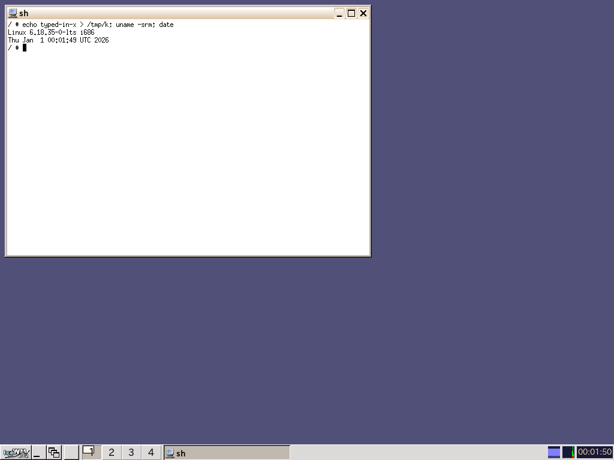
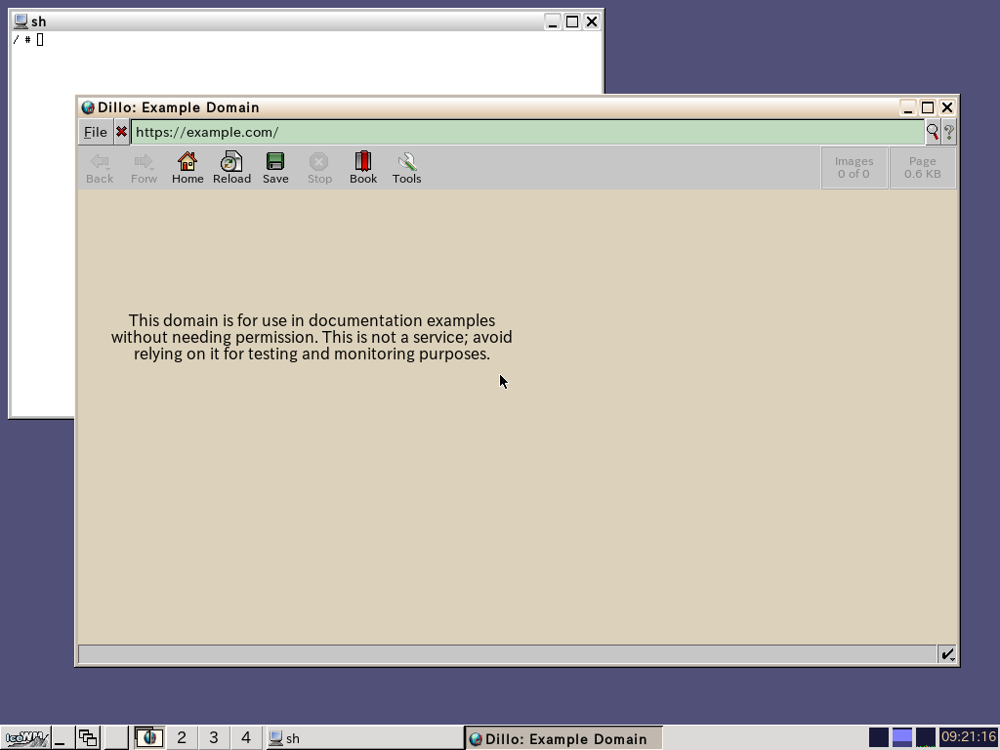

# g86m

An x86 emulator written in [Goose](https://github.com/aardappel/goose).
It is a rewrite of [rustx86](https://github.com/y6ui3i/rustx86) from scratch, not a port of its code.

What carries over from rustx86 is only what does not depend on the language: test binaries such as
boot sectors, expected values, and the record of pitfalls. rustx86 itself serves as the oracle:
its per-instruction trace is compared with g86m's.

## Status

M9 is done: a browser (Dillo) in X on g86m shows a page fetched over HTTPS. M8 before it: X on a
frame buffer, in a window on the host. M7: with `--net` the guest has a network card and reaches
the world through the host, and the i686 has MMX and SSE2. M6 before it: the guest has a clock and an IDE disk, and Linux takes an ext2 file system on that
disk as its root and writes it. M5 before it: g86m boots a 32-bit Linux kernel (6.18) to a busybox shell on its serial console. For
that the machine is an i686 with an x87 FPU. The FPU adds, subtracts, multiplies, divides and
compares on the 80-bit format, in integers; the square root and the functions are computed as
64-bit floats (E013 and E014 in the ledger say why the first matters and the second has not yet).

M4: g86m is a 386 with protected mode, paging and virtual-8086 mode, and it passes
[test386](https://github.com/barotto/test386.asm): the ROM reaches its final diagnostic code and
its 44,926 lines of output match the reference taken from real hardware byte for byte. Task
switching is not implemented. FreeDOS 1.4 (M3) and ELKS 0.9.1 (M2) boot and can be used by hand in
the terminal console, or driven by a script.
Twenty-one test traces match rustx86 line for line on the full 32-bit state at every
instruction boundary. The history and the numbers are in
[docs/experiments.md](docs/experiments.md); what Goose did that cost time is in
[docs/goose-notes.md](docs/goose-notes.md).

Four blog posts (in Japanese) tell how it went: the first day, to ELKS and FreeDOS, in
[Goose で x86 エミュレータを書き直す](https://pocraft.net/?p=957); the two days after, from
test386 to Linux, in
[Goose の x86 エミュレータで Linux を起動する](https://pocraft.net/?p=962); a day of making
the Linux boot twice as fast, in
[Goose の x86 エミュレータを 2 倍速くする](https://pocraft.net/?p=965); and another day and
another third, by measuring what the host waits for and not how many instructions it runs, in
[Goose の x86 エミュレータをさらに 3 割速くする](https://pocraft.net/?p=970).
A fifth collects what those five days taught about Goose (what to watch for when writing it, what
its generated code costs, how to tell what a change did) and times the Linux boot against
rustx86 on one day:
[Goose で x86 エミュレータを 5 日書いてわかったこと](https://pocraft.net/?p=976).
A sixth counts where g86m's code is smaller than rustx86's (mostly what is not built yet;
about a fifth is the language) and gives the reasons behind the [roadmap](docs/roadmap.md):
[Goose の x86 エミュレータは Rust 版よりなぜ小さいのか](https://pocraft.net/?p=979).
A seventh is the day the roadmap's first two stages were done: the JIT's trips back to the
interpreter counted and halved, a clock, a disk, a network, and MMX and SSE2 for the guest's TLS,
checked against rustx86:
[Goose の x86 エミュレータで HTTPS を通す](https://pocraft.net/?p=982).

| Stage | Goal | State |
|---|---|---|
| M0 | Check that the core of an emulator can be written in Goose | done |
| M1 | The 16-bit real-mode instruction set; a boot sector prints Hello, World | done |
| M2 | The ELKS shell | done |
| M3 | FreeDOS to the `A:\>` prompt | done (the installer was declined, not run) |
| M4 | 386 protected mode and paging; pass test386 | done (no task switching) |
| M5 | 32-bit Linux and busybox | done (no disk, no network, no clock chip) |
| M6 | A clock and a disk | done (E074, E075): the host's date, and a root file system on an IDE disk |

| M7 | A network | done (E076, E077): `wget https://...` in the guest fetches a page through the host. MMX and SSE2 came with it, which the guest's OpenSSL is compiled for |
| M8 | A screen | done by script (E078): X comes up on a frame buffer, takes the keyboard and the mouse; the window on the host is to be tried by hand |
| M9 | A browser | done (E079): Dillo, in X, shows a page fetched over HTTPS |

What comes after is in [docs/roadmap.md](docs/roadmap.md).
| M6 | A clock (CMOS/RTC) and an IDE disk | planned |
| M7 | A network: NE2000, and libslirp on the host | planned |
| M8 | A screen: Bochs VBE, SDL2, a PS/2 mouse; X comes up | planned |
| M9 | Browsing with NetSurf or Dillo | planned |
| M10 | x86_64 | planned |

Why the stages are in this order, and how each is checked, is in [docs/roadmap.md](docs/roadmap.md).

## Technology choices

Goose was the only new technology in the project until E059; there is now a second, behind an
option: code generated at run time (below). The rest is a C compiler (clang) and, once a screen is
needed, SDL2. Five small files of C do what Goose cannot: the terminal's raw mode
(`console.c`), executable memory (`jit.c`), reading and writing a disk image in place
(`disk.c`), the host side of the network (`net.c`), and the window (`screen.c`, SDL2, opened
with `dlopen` as libslirp is).

A third new technology came with M7: **libslirp**, the user-mode TCP/IP stack QEMU uses, for the
host side of `--net`. The dull alternatives were a tap device or macOS's vmnet, which need root
or an entitlement, and writing ARP, DHCP, DNS forwarding and TCP in Goose. It is not linked:
`net.c` opens it with `dlopen` when `--net` is given, so a build needs nothing of it (and
Goose's build file has no key for a library's directory).

Choosing Goose decides three things:

- **It does not run in a browser.** Goose's wasm output is a proposal and is not implemented. For now
  g86m runs natively in a terminal.
- **Goose by itself cannot run code it generates.** It has no function pointers. The interpreter is
  therefore where the speed first came from (E015 to E057 in the ledger), and it is the default.
- **With forty lines of C it can** (E058). `--jit` turns on a translator for arm64, written in Goose
  ([src/jit.goose](src/jit.goose)), that makes host code of runs of 32-bit guest instructions; the C
  ([src/jit.c](src/jit.c)) maps executable memory, copies code into it and calls it. The dull
  alternative, which is what was chosen first and kept, is the interpreter with fused pairs; the JIT
  was taken up when that was down to fractions of a percent a card (E052, E056), and it takes
  seven tenths off the Linux boot's cycles (E073; [docs/jit.md](docs/jit.md)). Without `--jit` nothing of it runs. It is for arm64
  hosts only; on any other, do not pass `--jit`.
- **Dispatch and the device bus are `enum` and `match`.** There is nothing like a trait or a vtable.

## Build

Goose is pinned to **v2026.4** ([release](https://github.com/aardappel/goose/releases/tag/v2026.4)).
One C compiler is needed (`goose toolchain` shows which one is found).

```bash
goose build -o build/g86m src/g86m.goose
```

```bash
./build/g86m testdata/hello.bin
```

With `--trace`, g86m prints the state at every instruction boundary, one line each.

A 64 KB or 128 KB image is a ROM that replaces the BIOS; `--com FILE` saves what it sends to the
serial port. Any other image that is not 512 bytes is booted as floppy drive A. Started from a terminal, it opens the
console: the guest's 80x25 text screen is drawn in the terminal, the keyboard goes to the guest,
and guest time is paced against real time. **Ctrl-]**, **F12** or **Ctrl-\\** leaves it. In a terminal smaller than 80
columns by 25 rows, the console shows the part of the screen around the guest's cursor.

```bash
./build/g86m images/fd2880.img
```

For FreeDOS, press Enter at the language menu, then `n` and Enter when the installer asks whether
to proceed. That leaves you at `A:\>`.

```bash
./build/g86m images/fd14boot.img
```

If the machine stops on something it does not implement, the console closes and says what it was.

`--wait` and `--type` script a session instead: each `--wait` runs until its text is on the screen,
each `--type` types at the keyboard. A scripted run is not paced and skips idle time.

```bash
./build/g86m --wait "login:" --type "root\n" --wait "# " --type "uname -a\n" --wait "i8086" images/fd2880.img
```

A Linux kernel image is loaded and entered directly, and the terminal becomes its serial console:
the boot log scrolls by, and after about 22 seconds there is a shell. **Ctrl-]** leaves.

```bash
./build/g86m --initrd images/initramfs-mini images/vmlinuz-lts
```

The 22 seconds are the guest's: guest time is counted in instructions, 76 million to the second
for this machine, and the console paces it against real time. A faster host does not shorten
them; a faster *guest* does. `--speed N` makes a second of guest time N times as many
instructions, which is a CPU N times as fast under the same clock, and `--jit` (arm64 hosts) is
what lets the host keep up with it:

```bash
./build/g86m --jit --speed 3 --initrd images/initramfs-mini images/vmlinuz-lts
```

| On an Apple M1, with `--jit` | Guest time to the shell | Real time |
|---|---:|---:|
| `--speed 1` (the default) | 21.6 s | 21.6 s |
| `--speed 2` | 11.6 s | 11.6 s |
| `--speed 3` | 8.3 s | 9.2 s |
| `--speed 4` | 6.7 s | 9.8 s |
| `--speed 8` | 4.4 s | 13.3 s |

Up to the speed the host can deliver, the guest's clock and the wall agree; beyond it the guest's
clock falls behind (a faster guest also spins more instructions in its own delay loops, so the
boot is more work). `--speed` changes how many instructions run between two timer ticks, so a
run's instruction count is its own for each speed; the tests use the default.

The guest has a clock (CMOS, ports 70h and 71h), which runs on guest time. Started from a
terminal it begins at the host's time, so `date` in the guest shows today's date in UTC; in a
scripted or headless run it begins at 2026-01-01, so that such a run is the same every time.
`--rtc host` and `--rtc SECONDS` (since 1970) say otherwise.

`--disk FILE` attaches an image as an IDE disk (the primary channel's master, PIO), read and
written in place. `tools/images/make-disk.sh` makes an initramfs that has the driver and a
32 MB ext2 image to be the root:

```bash
./build/g86m --jit --disk images/disk.img --initrd images/initramfs-disk images/vmlinuz-lts
```

What is written there is in the image the next time. The guest cannot turn the machine off:
`sync`, then Ctrl-].

`--net` gives the machine a network card (an NE2000 on PCI) and, behind it, the host as a
gateway, a DHCP server and a name server (10.0.2.2 and 10.0.2.3, the guest at 10.0.2.15), by
[libslirp](https://gitlab.freedesktop.org/slirp/libslirp), which is opened when the option is
given and has to be installed (`brew install libslirp`); no root is needed. The guest reaches
out through the host's own sockets:

```bash
./build/g86m --jit --net --initrd images/initramfs-mini images/vmlinuz-lts
```

```
~ # wget -q -O - https://example.com/ | grep title
```

`--fb 1024x768` gives a Linux kernel a frame buffer of that size, and, started from a terminal, a
window on the host that shows it and takes the keyboard and the mouse (SDL2, opened when the
option is given: `brew install sdl2`). A click in the window takes the pointer; Ctrl+Alt gives it
back. With the X disk that `tools/images/make-x-disk.sh` makes, the serial console stays in the
terminal and X comes up in the window:

```bash
./build/g86m --jit --fb 1024x768 --disk images/disk-x.img --initrd images/initramfs-disk images/vmlinuz-lts
```

```
~ # startx
```



With `--net` as well, the disk's init gets an address by DHCP and a browser has the world:

```
~ # startx &
~ # DISPLAY=:0 dillo https://example.com/
```



`--shot FILE` saves the frame buffer as a PPM image when the run ends, with or without a window.

`--unpaced` is the other way to stop waiting: real time is then spent only on the guest time that
passes while the machine is halted, so the boot takes 7.5 seconds with `--jit` at the default
speed and `sleep 3` still takes three, but the guest's clock runs ahead of the wall while it
computes. It is off unless asked for.

## Tests

```bash
tools/difftest.sh
```

With the images in `images/`, it also runs test386, scripted ELKS, FreeDOS and Linux sessions, and
drives the console through a pseudo-terminal ([tools/console_test.py](tools/console_test.py)). A session whose
image is missing is reported as skipped.

It assembles one boot sector per instruction group (`tests/asm/`) with NASM, runs each, and compares
the trace with the expected one in `tests/expected/`. The expected traces come from trace32
([tools/oracle/trace32.rs](tools/oracle/trace32.rs)), a small example added to rustx86.
To regenerate them, run `ORACLE=/path/to/trace32 tools/difftest.sh`.

## Layout

| File | Contents |
|---|---|
| [src/state.goose](src/state.goose) | Registers, flags, segment caches, control registers, 1 MB of RAM, paging, checked memory access, faults |
| [src/alu.goose](src/alu.goose) | Arithmetic and flags, shifts and rotates |
| [src/prot.goose](src/prot.goose) | Descriptors, segment loading, far transfers, interrupt and fault delivery, virtual-8086 mode |
| [src/exec.goose](src/exec.goose) | Instruction decode and execution; the cache of decoded instructions |
| [src/fpu.goose](src/fpu.goose) | The x87 FPU of the i686 machine |
| [src/sse.goose](src/sse.goose) | MMX and SSE2 of the i686 machine |
| [src/bios.goose](src/bios.goose) | Power-on setup and the BIOS services the emulator performs: screen, disk, keyboard, time |
| [src/dev.goose](src/dev.goose), [src/disk.c](src/disk.c), [src/net.c](src/net.c) | Interrupt controllers, timer, keyboard controller, CMOS clock, IDE disk, PCI and the network card, I/O port dispatch; the disk's image file and the host side of the network in C |
| [src/linux.goose](src/linux.goose) | Loading a Linux kernel and entering it directly (zero page, memory map, initramfs, frame buffer) |
| [src/screen.c](src/screen.c) | The window for the frame buffer: SDL2, keys and mouse |
| [src/console.goose](src/console.goose), [src/console.c](src/console.c) | The terminal console: drawing the screen, translating keys; raw terminal mode in C |
| [src/jit.goose](src/jit.goose), [src/jit.c](src/jit.c) | The JIT (`--jit`): a translator of blocks of guest instructions into arm64 code; executable memory and the call into it in C |
| [src/g86m.goose](src/g86m.goose) | The run loop, interrupt delivery, pacing, the serial console, the session script, the command line |
| [src/big.goose](src/big.goose) | The large arrays (RAM and three others), in a file of their own so they come last in memory |

The boot sectors in `testdata/` are copied from rustx86's `asm/` as they are, including the Japanese
comments in their sources. `probe/` holds the M0 probes.

## License

[MIT](LICENSE). The disk images g86m boots are not part of this repository and have licenses of
their own.
